<p align="center"></p>

<h1 align="center">Aangan</h1>

<p align="center"><b>A calm, private home screen, or launcher, for Android TV and Google TV.</b><br>
No ads. No tracking. No account. Just your apps, the sky outside, and the days that matter.</p>

<p align="center"><a href="https://vaari-dev.github.io/aangan/"><b>Website</b></a> · <a href="https://vaari-dev.github.io/aangan/install.html"><b>Install</b></a> · <a href="https://vaari-dev.github.io/aangan/guide.html">Guide</a> · <a href="https://vaari-dev.github.io/aangan/privacy.html">Privacy</a> · <a href="../../releases/latest/download/aangan.apk">Download the latest release</a></p>

<p align="center"><a href="https://github.com/vaari-dev/aangan/actions/workflows/ci.yml"></a> <a href="https://scorecard.dev/viewer/?uri=github.com/vaari-dev/aangan"></a></p>

---

*Aangan* (आँगन) is the courtyard at the heart of an Indian home. Aangan replaces your TV's stock home screen, with
its ads and recommendations, with something quiet and yours.

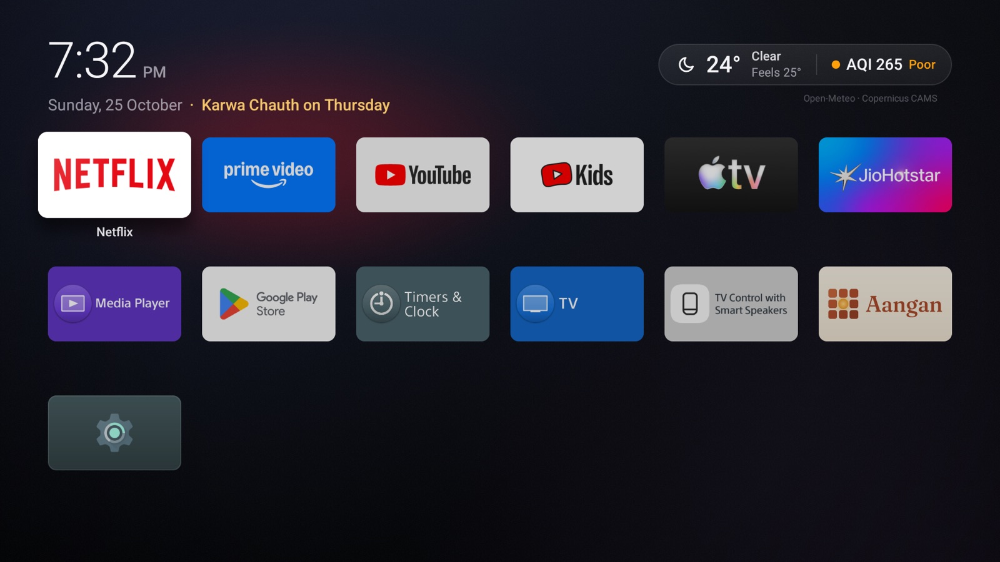

## What it does

- **Your apps.** A dock of four favourites you choose, which never rearranges itself, and every other app in a grid. Hold OK on an app to dock or hide it.
- **The sky outside.** Time, weather and air quality for your city. Pick from large cities or type a few letters; old names like Bombay or Gurgaon work.
- **Today.** Up then OK on the weather: the next hours, high and low, sunrise and sunset, UV, the moon, a 36-hour air-quality trend against your country's safe limit, and the best time to air out the house.
- **Festivals.** A countdown to the next one, and on the day a hand-drawn scene behind your apps. Move or hide any festival.
- **Family days.** Birthdays and anniversaries get balloons, confetti, rings and petals, with a greeting by name.
- **Screensaver.** A dim, drifting clock with the weather.
- **English or Hindi**, following the TV's language.

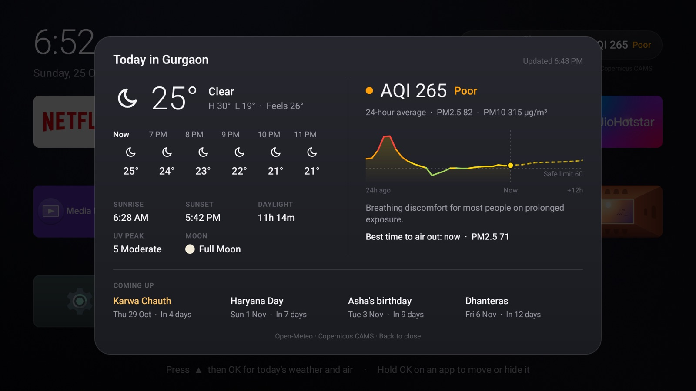

## Festivals and family days

| | |
|---|---|
| 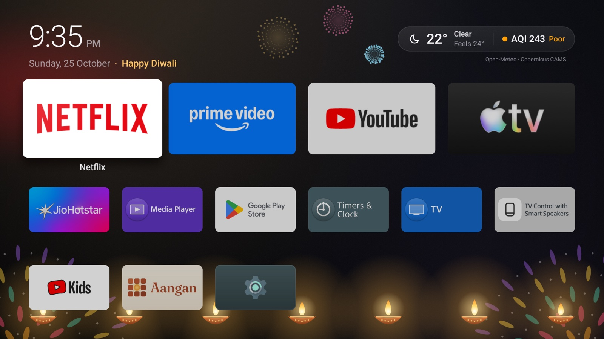 Diwali: diyas, rangoli and fireworks | 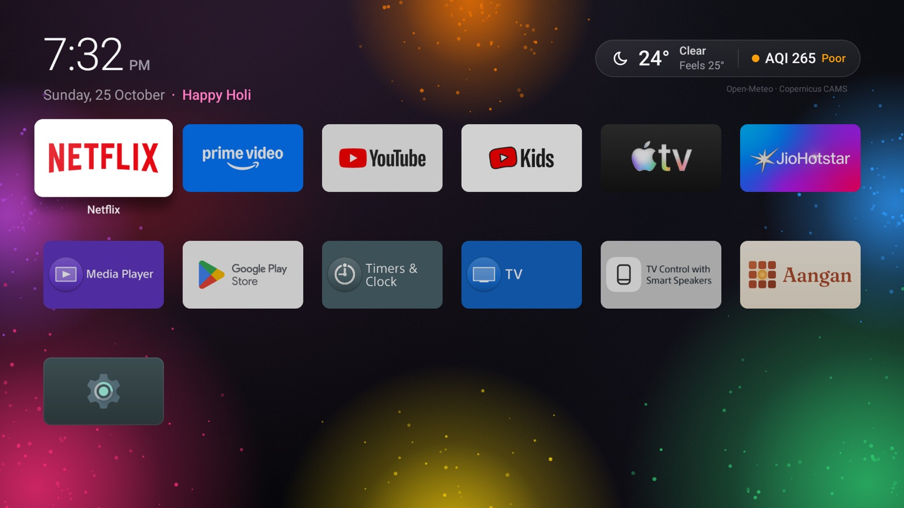 Holi: clouds of gulal |
| 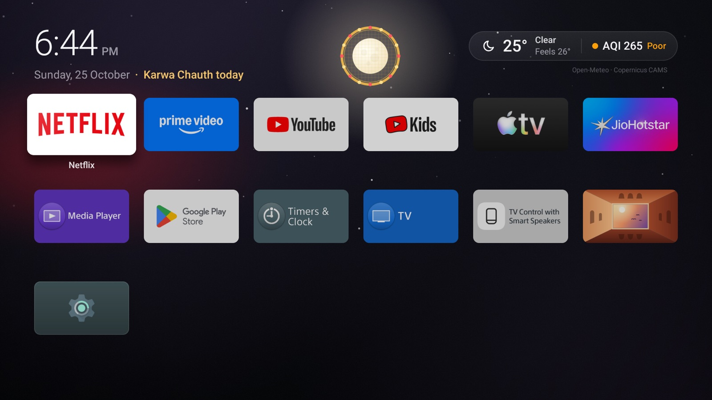 Karwa Chauth: the moon through the chalni | 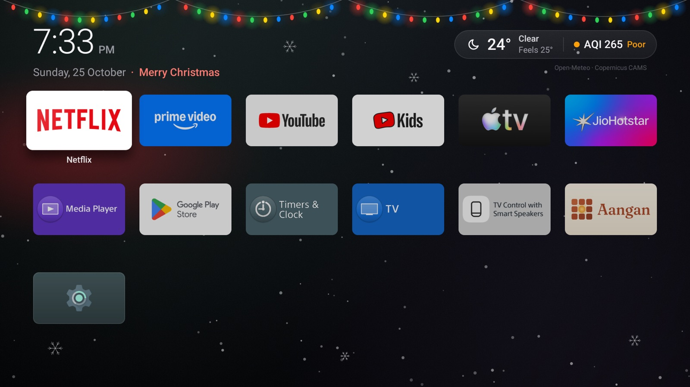 Christmas: lights and snow |
| 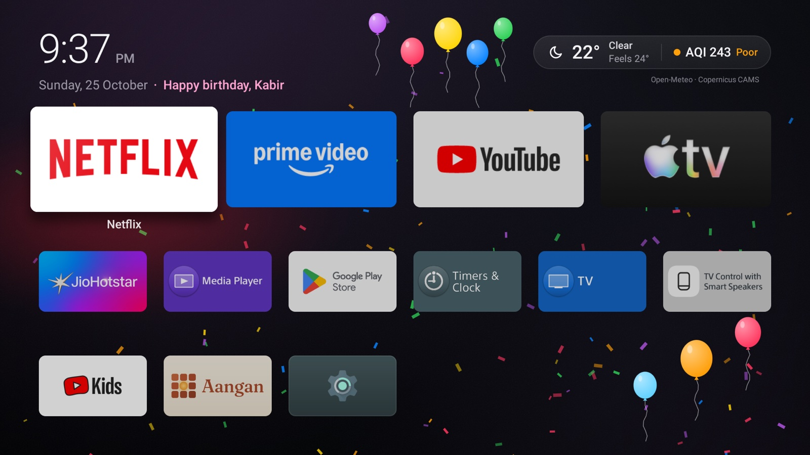 A birthday: balloons and confetti | 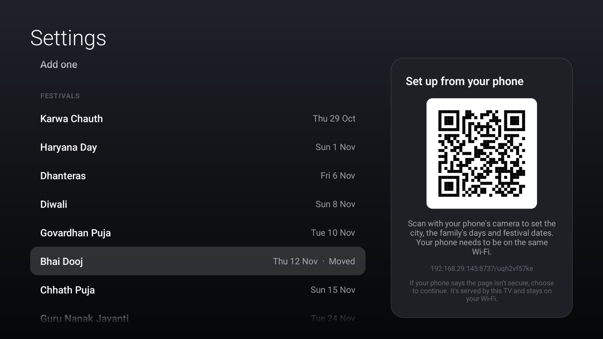 Festival dates you can move or hide |

Scenes for Lohri, Makar Sankranti, Basant Panchami, Holi, Navratri, Dussehra, Karwa Chauth, Diwali week, Chhath,
Gurpurab, Raksha Bandhan, Janmashtami, Ganesh Chaturthi, Eid, Christmas, New Year, Republic Day, Independence Day,
birthdays and anniversaries. They move only while the home screen is showing.

## Private by design

- No ads, analytics, crash reporting or account. A crash leaves a note on the TV, which you can report yourself from the phone page.
- No location permission. You choose your city; Gurgaon is the default.
- Network use: [Open-Meteo](https://open-meteo.com) weather for your city (two requests, at most every 30–60 minutes, only while the home screen is showing), city search when you ask, and the phone page below.
- Family days stay on the TV. To move to a new TV, export a backup from the phone page and import it there.
- On an ordinary day nothing animates, so Aangan uses no CPU while you watch.

## Install

Android TV and Google TV 9 or later: Sony, TCL, Hisense, Philips, Xiaomi, Chromecast with Google TV and others.
Tested on Sony Bravia (Android TV 9, Google TV 12) and emulators for Android TV 13, Google TV 14 and Google TV 16.
Samsung (Tizen), LG (webOS), Roku and Fire TV don't allow another home screen; plug in a Google TV or Android TV
streamer instead ([why](https://vaari-dev.github.io/aangan/faq.html#samsung)).

1. On the TV, install **Downloader** (by AFTVnews) from Google Play.
2. In Downloader, enter:

   ```
   https://github.com/vaari-dev/aangan/releases/latest/download/aangan.apk
   ```

   When the TV says it can't install from this source, choose **Settings**, switch Downloader on, and press Back. (Later: **Settings → Apps → Security** on Google TV, **Settings → Device Preferences → Security & restrictions** on older Android TV.) This isn't developer mode.
3. Choose **Install**. The same link updates it.
4. Open **Aangan**. The welcome covers the rest:

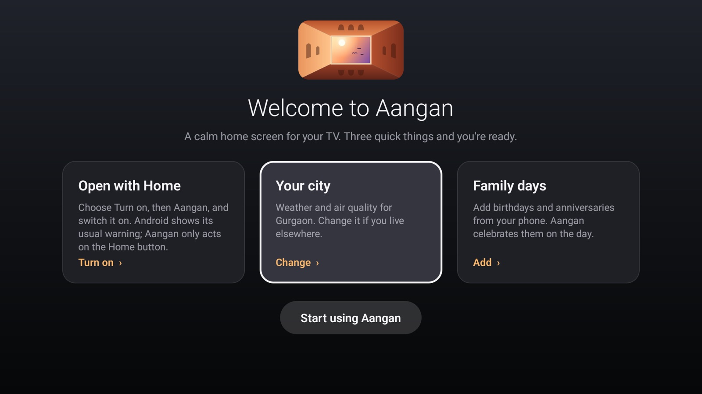

- **Open with Home.** Choose *Turn on*, then *Aangan*, and switch it on. Home and switching the TV on then bring up Aangan.
  - Android warns about accessibility services. Aangan's reacts only to Home; other buttons pass through, and it can't see the screen.
  - On Android 13+, if Aangan is greyed out, open **Settings → Apps → Aangan → Allow restricted settings** and try again.
- **Your city.** Defaults to Gurgaon.
- **Family days.** Easiest from your phone, below.

> With adb you can make Aangan the true default home: `adb shell cmd package set-home-activity dev.vaari.aangan/.HomeActivity`.

## Set up from your phone

Aangan's Settings show a QR code. Scan it on the same Wi-Fi to choose the city, set the dock, edit family days and
move or hide festivals from your phone's browser. The TV serves the page itself:

- only while Settings is open;
- at an address with a fresh one-time secret;
- on your home network only, loading nothing from the internet.

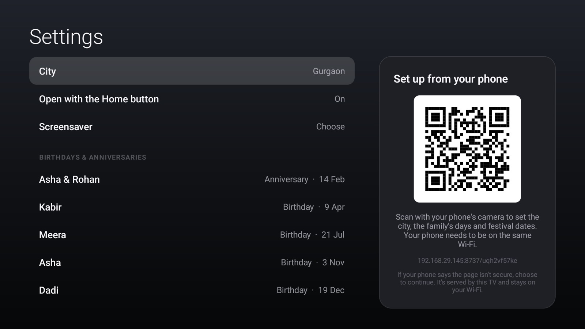

<p align="center">
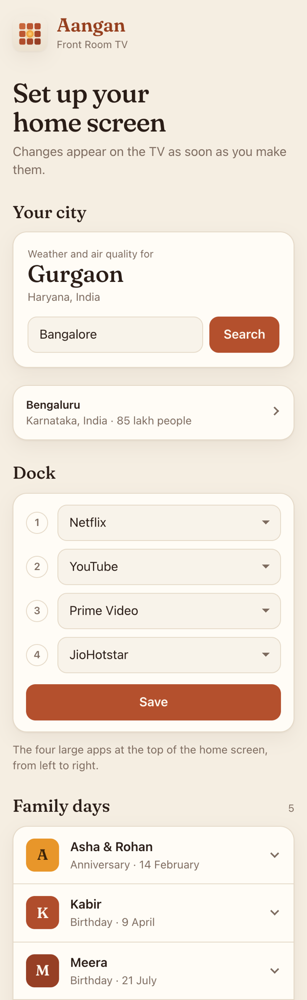&nbsp;&nbsp;
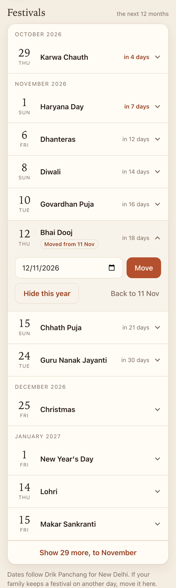
</p>

> **"Not secure"?** Browsers warn about any page without HTTPS, and a TV on a home network can't get a certificate
> without a cloud service in between. Continue: the page never leaves your Wi-Fi.

## Contributing

Building, testing, festival dates and translations: [`CONTRIBUTING.md`](CONTRIBUTING.md). Security: [`SECURITY.md`](SECURITY.md).

## Credits

- Weather and air quality: [Open-Meteo](https://open-meteo.com) (CC BY 4.0), with Copernicus CAMS.
- Air-quality scale: CPCB National AQI in India, US EPA AQI elsewhere.
- Typeface: [Fraunces](https://github.com/undercasetype/Fraunces) by Undercase Type, SIL Open Font Licence (`app/src/main/assets/phone/OFL-Fraunces.txt`).

[MIT licence](LICENSE).
